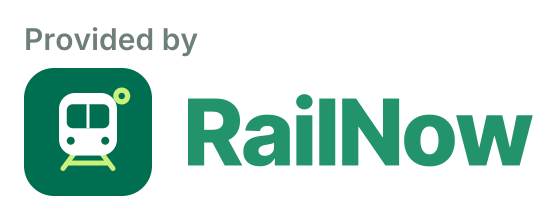

<p align="center">
  <a href="https://railnow.runvia.app">
    <picture>
      <source media="(prefers-color-scheme: dark)" srcset="assets/railnow-logo-dark.svg">
      
    </picture>
  </a>
</p>

<p align="center">
  <b>Free REST API for real-time train positions in the Seoul Metropolitan Subway.</b><br>
  Where is my train, right now?
</p>

<p align="center">
  <a href="https://railnow.runvia.app/api/docs/en"></a>
  <a href="openapi/openapi.en.json"></a>
  <a href="https://railnow.runvia.app/api/docs/en/json"></a>
  <a href="https://railnow.runvia.app/developer?lang=en"></a>
</p>

<p align="center">
  <a href="README.ko.md">한국어</a> ·
  <a href="https://railnow.runvia.app">Website</a> ·
  <a href="https://railnow.runvia.app/developer?lang=en">Developer Portal</a> ·
  <a href="https://railnow.runvia.app/api/docs/en">API Docs</a> ·
  <a href="https://github.com/hongjunna/railnow-api/discussions">Discussions</a>
</p>

---

RailNow tracks every train on the Seoul Metropolitan Subway. It collects real-time arrival feeds every few minutes and calibrates them against official timetables, so you get each train's current position, next station, delay in seconds and destination. You can also get station arrival boards, timetables, station-to-station distances and measured travel time statistics.

This repository holds the public documentation, the OpenAPI spec and code examples. The API itself is not open source.

## Links

| | |
|---|---|
| Official website | https://railnow.runvia.app |
| API documentation | https://railnow.runvia.app/api/docs (Korean) · https://railnow.runvia.app/api/docs/en (English) |
| Developer portal (API keys) | https://railnow.runvia.app/developer |
| RapidAPI | https://rapidapi.com/hongjunna/api/railnow |
| Postman documentation | https://documenter.getpostman.com/view/59032951/2sBYHSxfc7 |
| OpenAPI spec | [`openapi/openapi.en.json`](openapi/openapi.en.json) · https://railnow.runvia.app/api/docs/en/json |
| Discussions | https://github.com/hongjunna/railnow-api/discussions |

## Features

- **Real-time train positions.** Every active train on a line, or one train by number, calibrated to the second against the timetable.
- **Station arrival boards.** Trains approaching a station within 5 stops, by direction, with arrival time in seconds.
- **Timetables.** The full stop-by-stop timetable of a train, with weekday, Saturday and holiday schedules.
- **Stations.** Search by name or by Korean initial consonants (`ㄱㄴ` → 강남), transfers, coordinates, addresses and English names.
- **Distances and travel times.** Distances between stations, scheduled travel times, and travel times actually measured by time slot.
- **English responses.** Add `lang=en` to any request to get station names, statuses and messages in English.
- **No Korean phone verification.** Sign in with Google and get a key in under a minute.

## Quick start

**1. Get a free API key.**

1. Open the [Developer Portal](https://railnow.runvia.app/developer?lang=en) and sign in with Google.
2. Click **Create API key** and agree to the terms of use.
3. Enter a key name, purpose and contact email. Leave **Allowed domains** empty unless you call the API from a browser.
4. Copy the key (`jl_...`). It is shown only once, so store it somewhere safe.

Keep your key out of source control. Load it from an environment variable or a secret store, and never put it in a public repository or in client-side code that ships to users.

**2. Make a request.**

```bash
export RAILNOW_API_KEY="jl_your_key"

# Lines that support real-time tracking
curl -H "X-API-Key: $RAILNOW_API_KEY" \
  "https://railnow.runvia.app/api/v1/train/lines?lang=en"

# Every active train on Line 2 right now
curl -H "X-API-Key: $RAILNOW_API_KEY" \
  "https://railnow.runvia.app/api/v1/train/lines/1002/trains?lang=en"
```

Each request should return JSON. A `401` means the key is missing or mistyped.

**3. Show the attribution logo.** Every screen that displays RailNow data must show our logo. See [Attribution](#attribution).

More examples are in [`examples/`](examples): [curl](examples/curl/quickstart.sh), [JavaScript](examples/javascript/quickstart.mjs) and [Python](examples/python/quickstart.py).

## Endpoints

Base URL: `https://railnow.runvia.app`. Every endpoint below is `GET` and requires the `X-API-Key` header.

### Train

| Endpoint | Description |
|---|---|
| `/api/v1/train/lines` | Lines that support real-time train tracking |
| `/api/v1/train/lines/{lineId}/trains` | Real-time positions of every active train on a line. Filter with `direction` (`UP`/`DOWN`) and `trainType` (`EXPRESS`/`LOCAL`). |
| `/api/v1/train/{trainNo}?lineId=` | Status and history of one train: position, next station, delay |
| `/api/v1/train/{trainNo}/timetable?lineId=` | Full stop-by-stop timetable of one train |
| `/api/v1/line-map/{lineId}` | Schematic line sections for drawing a route map |

### Station

| Endpoint | Description |
|---|---|
| `/api/v1/station/lines` | All subway lines |
| `/api/v1/station/search?q=` | Search stations by name or Korean initial consonants. Filter with `lineId`. |
| `/api/v1/station/{keyword}` | Station details by ID or name |
| `/api/v1/station/{stationId}/board` | Real-time arrival board for a station |
| `/api/v1/station/{stationId}/transfers` | Transfer lines at a station |
| `/api/v1/station/distances` | Distances and scheduled travel times between stations |

### Timetable, analytics and status

| Endpoint | Description |
|---|---|
| `/api/v1/timetable/` | Search timetables by train number, line, station and date |
| `/api/v1/analytics/segment-travel-stats` | Measured travel time statistics per segment, by day type and time slot |
| `/api/v1/data-status/` | Data coverage and freshness for each line |
| `/api/v1/data-status/{lineId}` | Detailed data status for one line |
| `/api/v1/realtime/all` | Raw snapshot of the Seoul subway real-time arrival feed |
| `/api/v1/realtime/train/{trainNo}` | Raw real-time records of one train |

The [API reference](https://railnow.runvia.app/api/docs/en) lists every parameter and response field, and you can try requests there. The `/api/v1/calibration/*` endpoints are deprecated; use `/api/v1/train/*` instead.

### Common parameters

| Parameter | Description |
|---|---|
| `lang` | `en` for English values (`Arrived`, `Up`, `Gangnam`). Without it, values are in Korean (`도착`, `상행`, `강남`). |
| `date` | Service date (`YYYY-MM-DD`). Defaults to today in KST. |
| `simple` | `true` reduces statuses to arrived or moving. |
| `detail` | `true` adds `progress` and `nextAction`. |
| `smooth` | `true` smooths positions between real-time updates. |

## Line IDs

| ID | Line | ID | Line |
|---|---|---|---|
| `1001` | Line 1 | `1063` | Gyeongui–Jungang Line |
| `1002` | Line 2 | `1065` | AREX (Airport Railroad) |
| `1003` | Line 3 | `1067` | Gyeongchun Line |
| `1004` | Line 4 | `1075` | Suin–Bundang Line |
| `1005` | Line 5 | `1077` | Shinbundang Line |
| `1006` | Line 6 | `1081` | Gyeonggang Line |
| `1007` | Line 7 | `1092` | Ui–Sinseol Line |
| `1008` | Line 8 | `1093` | Seohae Line |
| `1009` | Line 9 | `1094` | Sillim Line |
| `1032` | GTX-A | | |

Call `/api/v1/train/lines` for the current list of lines with real-time tracking. Lines without a public timetable (Ui–Sinseol, GTX-A, Shinbundang, Sillim) return `mode: "RAW"`: raw real-time positions without delay calibration.

## Train modes

`/api/v1/train/{trainNo}` returns a `mode` that tells you how the position was determined.

| `mode` | Meaning |
|---|---|
| `LIVE` | Position calibrated with real-time data |
| `ESTIMATED` | No real-time data. The position is estimated from the timetable. |
| `SCHEDULED` | The train has not left its origin station yet. |
| `ENDED` | The train arrived at its terminal and is out of service. |
| `RAW` | The line has no timetable. Raw real-time position only. |

## Authentication and limits

- Send your key in the `X-API-Key` header.
- Each key allows **500 requests per hour** and **5,000 requests per day**. Both windows start when the key is issued.
- A key is valid for one year. You can extend it from one month before it expires.
- You can restrict a key to approved domains. Browser requests from other origins are rejected.

| Status | Body | Cause |
|---|---|---|
| `401` | `{"error":"Invalid or expired API key"}` | Missing, wrong or expired key |
| `403` | `{"error":"Domain is not allowed for this API key"}` | The request origin is not an approved domain. |
| `429` | `{"error":"..."}` | Rate limit exceeded. Wait for the seconds in the `Retry-After` header. |

Validation errors (`400`, `404`) return `{"statusCode", "error", "message"}`, where `message` explains the cause in Korean.

If you get `403` with the plain-text body `error code: 1010`, our CDN rejected your client's User-Agent. Python's built-in `urllib` is blocked this way. Send your own `User-Agent` header, as the [Python example](examples/python/quickstart.py) does.

RailNow is also on [RapidAPI](https://rapidapi.com/hongjunna/api/railnow), where you can subscribe with your RapidAPI account. If you do, link the RapidAPI account in the Developer Portal to see usage and logs there.

## Attribution

**Every service that uses RailNow data must show our logo on screens that display the data.** We recommend the "Provided by" logo. Choose the variant that fits your background, link it to https://railnow.runvia.app where possible, and do not stretch, recolor or alter it.

<p>
  <a href="https://railnow.runvia.app"></a>
</p>

```html
<a href="https://railnow.runvia.app" target="_blank" rel="noopener">
  
</a>
```

| Background | "Provided by" logo | Wordmark |
|---|---|---|
| Light | [SVG](https://railnow.runvia.app/brand/railnow-provided-by-light.svg) · [PNG](https://railnow.runvia.app/brand/railnow-provided-by-light.png) | [SVG](https://railnow.runvia.app/brand/railnow-logo-light.svg) · [PNG](https://railnow.runvia.app/brand/railnow-logo-light.png) |
| Dark | [SVG](https://railnow.runvia.app/brand/railnow-provided-by-dark.svg) · [PNG](https://railnow.runvia.app/brand/railnow-provided-by-dark.png) | [SVG](https://railnow.runvia.app/brand/railnow-logo-dark.svg) · [PNG](https://railnow.runvia.app/brand/railnow-logo-dark.png) |
| Any | [SVG](https://railnow.runvia.app/brand/railnow-provided-by-universal.svg) · [PNG](https://railnow.runvia.app/brand/railnow-provided-by-universal.png) | [SVG](https://railnow.runvia.app/brand/railnow-logo-universal.svg) · [PNG](https://railnow.runvia.app/brand/railnow-logo-universal.png) |

Square icon: [SVG](https://railnow.runvia.app/brand/railnow-icon.svg) · [PNG 512×512](https://railnow.runvia.app/brand/railnow-icon.png). The logo URLs allow cross-origin requests, so you can embed them directly.

## OpenAPI spec

[`openapi/openapi.en.json`](openapi/openapi.en.json) is the English OpenAPI 3.0.3 spec. Use it to generate a client with [OpenAPI Generator](https://openapi-generator.tech) or to import the API into Postman or Insomnia. The live spec is always at https://railnow.runvia.app/api/docs/en/json. A [GitHub Actions workflow](.github/workflows/openapi-sync.yml) checks it every day and opens a pull request when it changes.

```bash
npx @openapitools/openapi-generator-cli generate \
  -i https://railnow.runvia.app/api/docs/en/json -g typescript-fetch -o ./railnow-client
```

## Data sources and accuracy

RailNow combines public real-time arrival data from the Seoul Open Data Plaza with timetables from the Korea Rail Network Authority (KRIC) and operators. See the [full list of data sources](https://healthy-sail-1cd.notion.site/3e2ee71053db800f8f4ee381bf6e1aa0?source=copy_link).

Positions between real-time updates are estimates. Source data can be delayed or missing, and coverage is limited to supported lines in South Korea. Do not use RailNow for safety-critical purposes.

## Support

| Where | Use it for |
|---|---|
| [Issues](https://github.com/hongjunna/railnow-api/issues/new/choose) | Bugs: wrong data, errors, unexpected responses, documentation mistakes |
| [Discussions](https://github.com/hongjunna/railnow-api/discussions) | Questions about using the API (Q&A), feature ideas (Ideas), projects built with RailNow (Show and Tell), announcements of API updates |
| [junlab0801@gmail.com](mailto:junlab0801@gmail.com) | Outages, questions about your API key or account, anything private |

Never post your API key in an issue or discussion.

## License and terms

- **Documentation and code examples in this repository** are licensed under the [MIT License](LICENSE). The license covers nothing else; see [NOTICE](NOTICE.md). You may copy the examples into your own projects.
- **The RailNow API service and the data it provides** are not covered by the MIT License. They are governed by the [API terms of use and privacy policy](https://healthy-sail-1cd.notion.site/API-3e2ee71053db80d28500db98f8dd0532?source=copy_link), which you accept when you issue an API key.
- **The RailNow name, logos and brand assets**, including the files in [`assets/`](assets), are not covered by the MIT License. You may use them only to credit RailNow as the data provider, following the [attribution rules](#attribution). Do not use them in a way that suggests RailNow endorses or operates your service.
- The OpenAPI spec in [`openapi/`](openapi) describes the API and is published so that you can generate clients. Using the API it describes is still subject to the terms of use.
